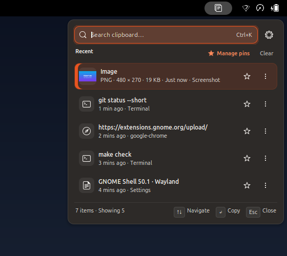

# Cliporium

[](https://github.com/engida32/cliporium/actions/workflows/ci.yml)

Cliporium is a keyboard-first clipboard manager for GNOME Shell 50. It keeps
text and image history on your machine, with fast search, pins, previews, and
no network access.

The GNOME extension is self-contained. It runs inside the Shell process and
stores history in your user data directory. No daemon, bundled binary, or
external database is required.



*Screenshot from GNOME Shell 50.1 on Wayland. The clipboard items are synthetic.*

## Features

- Captures plain text and PNG or JPEG images when the extension is enabled.
- Deduplicates repeated text and image content and moves the existing item to
  the top.
- Provides a compact popup with search, settings, a Recent header, a scrollable
  list, and keyboard hints.
- Filters as you type and focuses the search field when the popup opens.
- Supports keyboard navigation, Enter to copy, Delete to remove, Escape to clear
  or close, `Ctrl+K` to focus search, `Ctrl+P` to pin, and `Ctrl+1` through
  `Ctrl+9` to copy pinned items.
- Pins up to 100 items. Pinned items survive history trimming and have a
  dedicated Pinned items view with scoped search and keyboard shortcuts.
- Shows image thumbnails with MIME type, dimensions, and size. Opens a larger
  preview with Copy image, Open image, Pin image, and Close preview actions.
- Exposes row actions for copy, pin or unpin, and delete. The more button opens
  the same actions inline.
- Clears unpinned history or all history with a two-step confirmation.
- Includes private mode and a separate capture on/off switch.
- Follows the Shell light and dark color scheme.
- Configures the history limit, text size limit, image size limit, retention
  period, panel indicator visibility, and an optional keyboard shortcut. The
  shortcut is unset by default.
- Writes atomically, validates data on load, and recovers from missing,
  malformed, or incompatible history files.

## Requirements

- GNOME Shell 50 on the Wayland session shipped with Ubuntu 26.04. This release
  does not support X11. The target host has no X11 session files, and
  `gnome-shell --help` exposes no X11 option.
- `gnome-extensions` from GNOME Shell for installing and managing the extension.
- `glib-compile-schemas` from `libglib2.0-bin` for installing the GSettings
  schema.
- GJS 1.88 or newer and GNU Make for development.
- Rust 1.97 or newer only if you want to run the Rust workspace tests.

## Installation

### GNOME Extensions

The recommended path is the GNOME Extensions listing. After the listing is
approved, open <https://extensions.gnome.org/> or search for Cliporium in
Extension Manager, then enable the extension.

### Release ZIP

Download the ZIP from the project's GitHub Releases page when a release is
available. Then run:

```sh
gnome-extensions install --force \
  cliporium@engida32.github.io.shell-extension.zip
gnome-extensions enable cliporium@engida32.github.io
```

Log out of the desktop and log back in. On Wayland, locking and unlocking does
not reload the Shell.

### From source

Use this path for development or when testing an unreleased change.

```sh
git clone https://github.com/engida32/cliporium.git
cd cliporium
make pack
gnome-extensions install --force \
  dist/cliporium@engida32.github.io.shell-extension.zip
gnome-extensions enable cliporium@engida32.github.io
```

Log out and log back in. The running Shell caches the installed extension
module, so a reload alone is not enough on Wayland.

### Uninstall

```sh
gnome-extensions disable cliporium@engida32.github.io
gnome-extensions uninstall cliporium@engida32.github.io
```

Uninstalling does not remove clipboard history. To delete it as well:

```sh
rm -rf "${XDG_DATA_HOME:-$HOME/.local/share}/cliporium"
```

### Preferences

Open the preferences window to set a keyboard shortcut:

```sh
gnome-extensions prefs cliporium@engida32.github.io
```

## Usage

Click the clipboard icon in the panel, or use the shortcut you configured. Type
to filter, use Up and Down to move, press Enter to copy the selected item, and
press Escape to clear the query or close the popup.

Every row has an icon derived from its content. Click a text row to copy it.
Click an image row to open its preview. Use the row pin and more buttons for
quick actions. The more button opens an inline action bar with Copy, Pin or
Unpin, and Delete.

Manage pins opens a dedicated Pinned items view with a back button and search
scoped to pinned items. Clear in the Recent header opens an inline confirmation
for unpinned items, with a second step for deleting everything including pinned
items.

Keyboard shortcuts:

- `Ctrl+K` focuses the search field.
- `Ctrl+P` pins or unpins the selected item.
- `Ctrl+1` through `Ctrl+9` copy the first through ninth pinned item.
- `Enter` copies the selected item.
- `Delete` removes the selected item when the search field is empty. While
  searching, Delete edits the query.
- `Up` and `Down` move through pinned and recent items. `Home` and `End` jump to
  the ends when the search field is empty.
- `Escape` clears the query, closes an inline confirmation or action bar, leaves
  the pinned view, then closes the popup.

## Storage and privacy

History is stored at:

```text
$XDG_DATA_HOME/cliporium/history.json
$XDG_DATA_HOME/cliporium/images/
```

Image bytes are content-addressed by SHA-256. Deleting or clearing an item also
removes its image file after the history save succeeds.

The extension reads clipboard text and images to provide local history. It does
not use the network, telemetry, or analytics, and it does not log clipboard
contents.

Clipboard history can contain sensitive information. Use private mode or turn
capture off when you do not want an item stored. Clear history from the popup,
or remove the data directory to delete everything.

## Development

`make test` runs metadata validation, the GJS suites, and JavaScript syntax
checks. `make check` adds the Rust format, lint, and test runs, plus the
headless probes and an isolated clean install and uninstall when GNOME Shell 50
is available. `make clean-install` runs only the clean install and uninstall
probe against the packed ZIP.

Run the GJS unit tests directly:

```sh
gjs -m tests/history.test.js
gjs -m tests/storage.test.js
gjs -m tests/display.test.js
gjs -m tests/image-store.test.js
gjs -m tests/image-utils.test.js
gjs -m tests/clipboard.test.js
gjs -m tests/copy-payload.test.js
gjs -m tests/stylesheet.test.js
gjs -m tests/bench_history.js
```

Run the headless Shell probes on GNOME Shell 50:

```sh
bash tests/headless-toolbar-probe.sh
bash tests/headless-pinned-probe.sh
bash tests/headless-image-probe.sh
CLIPORIUM_TEXT_SCALE=2.0 bash tests/headless-toolbar-probe.sh
```

Check JavaScript syntax:

```sh
node --check extension/extension.js
node --check extension/prefs.js
for file in extension/src/*.js; do node --check "$file"; done
```

The repository also contains a Rust workspace for a possible future desktop
application. It is not part of the extension package and is not required for
the GNOME release.

### Backup and restore CLI

The Rust workspace includes `cliporium-backup`, a verified backup tool for the
Rust daemon data directory. It writes the SQLite database, referenced image
blobs, and a checksum manifest into a directory bundle. Restore verifies the
whole bundle before touching the destination and keeps a pre-restore copy.

```sh
cargo run -p clip-backup --bin cliporium-backup -- create \
  --data-dir "$XDG_DATA_HOME/cliporium" \
  --output "$HOME/cliporium-backup"

cargo run -p clip-backup --bin cliporium-backup -- verify \
  "$HOME/cliporium-backup"

cargo run -p clip-backup --bin cliporium-backup -- restore \
  "$HOME/cliporium-backup" \
  --data-dir "$XDG_DATA_HOME/cliporium"
```

Stop any running Cliporium daemon before restoring. The CLI does not back up
the extension's JSON history. Extension-side backup remains unimplemented.

The Rust store enforces a 64 KiB text cap and an 8 MiB PNG/JPEG cap. It creates
its data directory and blob tree with 0700 permissions, files with 0600, runs
`PRAGMA quick_check` on open, and removes unreferenced blob files during startup
reconciliation.

## Architecture

```text
extension/
  extension.js        extension lifecycle, indicator, popup, keyboard handling
  prefs.js            Adwaita preferences window
  src/clipboard.js    guarded clipboard text and image reader
  src/copy-payload.js MIME-aware copy payload selection
  src/display.js      relative time, content icons, titles, and row metadata
  src/history.js      history model, dedupe, pinning, limits, retention
  src/image-store.js  content-addressed image files, asynchronous writes
  src/image-utils.js  image dimension checks, decode, MIME labels, byte formatting
  src/search.js       query matching across text and image labels
  src/storage.js      atomic JSON persistence, image cleanup, and recovery
  schemas/            GSettings schema
  stylesheet.css      popup styling
tests/                GJS unit tests and headless Shell probes
```

The Shell process imports Shell, St, Clutter, Meta, GLib, GObject, Gio, and
Pango modules. The preferences process imports GTK, GDK, Adwaita, Gio, and the
preferences API.

## Compatibility and limits

- Tested headlessly on GNOME Shell 50.1 Wayland. Live GNOME 50.1 checks passed
  for activation, popup layout, search, text and image capture, private mode,
  capture-off suppression, shortcut opening, accessible name, and startup
  behavior. Remaining manual gates are listed in
  [`docs/live-verification.md`](docs/live-verification.md).
- The popup is capped at 420 px wide and scrolls its recent list after roughly
  six rows, so it stays a card rather than filling the screen.
- Supports text and PNG/JPEG images. Image headers are checked before decode;
  images over 8192 pixels on either side or 16 megapixels are rejected. Image
  blob writes are asynchronous, while decode remains in the Shell process and is
  bounded by those limits.
- Application exclusions and extension-side backup and restore are not
  implemented. The Rust backup CLI covers the Rust daemon data directory only.
- The extension stores JSON with atomic replacement. It does not claim SQLite
  durability or transactional guarantees.
- GNOME Extensions review is not guaranteed.

## Publishing

GNOME Extensions is the review and distribution authority. Extension Manager is
a client that installs from GNOME Extensions. The release steps are documented
in [`docs/publishing.md`](docs/publishing.md), and the listing copy and
screenshot plan are in [`docs/listing.md`](docs/listing.md).

The metadata URL and UUID use the `engida32` account namespace. The public
repository is <https://github.com/engida32/cliporium>. `develop` is the default
branch until the first release. Replacing the URL with a different owner
requires updating `metadata.json` and the pack command.

## Author

Engida Lishan is the author and maintainer.

- Website: <https://engida.devs.et/>
- GitHub: <https://github.com/engida32>

## License

MIT. See [`LICENSE`](LICENSE). MIT is compatible with the GPL-2.0-or-later terms
used by GNOME Shell.
